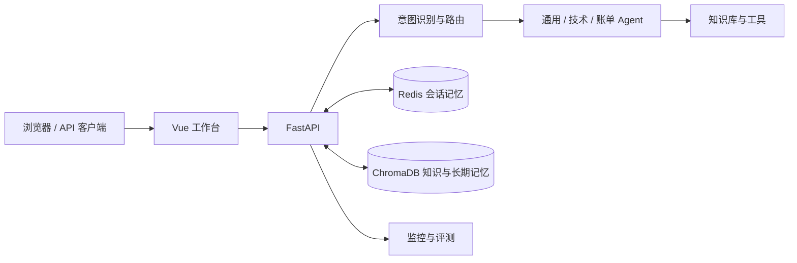

# NexusAgent

一个面向客服场景的多 Agent 应用。用户问题经过意图识别和路由后，由通用、技术或账单 Agent 处理；需要时检索知识库、调用工具，并保存会话上下文。仓库提供 FastAPI 服务和 Vue 工作台，可以查看路由结果、工具轨迹、知识库和评测报告。

> 这是可运行的作品集项目。聊天和自动评测需要你自己的模型服务凭据；仓库不包含真实密钥、用户数据或预生成的评测分数。

## 项目看点

- **多 Agent 编排**：细粒度意图识别、领域路由、主辅 Agent 协作及失败回退。
- **知识增强**：ChromaDB 存储知识片段，支持检索、文档上传和按需调用 RAG 工具。
- **分层记忆**：Redis 保存近期对话，ChromaDB 支持长期检索和用户画像。
- **动态 Skills**：按 Agent 类型与请求内容加载业务规范，支持热重载。
- **可观测与评测**：请求工具轨迹、监控指标、异步评测任务及回归比较。
- **可交互工作台**：对话、知识库管理、评测和连接配置集中在 Vue 页面。

## 架构



后端使用 Python 3.12、FastAPI、Redis 和 ChromaDB；前端使用 Vue 3、Vite 和 Nginx。外部模型通过 Anthropic SDK 接入，可在 `.env` 中配置支持相应接口的模型服务。

## 快速启动

需要 Docker Compose 和可用的模型 API Key。首次构建会安装依赖并下载本地 Embedding 模型，因此需要网络连接。

```bash
cp .env.example .env
# 编辑 .env，填写 ANTHROPIC_API_KEY、ANTHROPIC_MODEL；如需兼容端点，填写 ANTHROPIC_BASE_URL
docker compose up --build -d
```

启动后访问：

| 入口 | 地址 |
| --- | --- |
| Web 工作台 | <http://localhost:5174> |
| API 文档 | <http://localhost:8000/docs> |
| 健康检查 | <http://localhost:8000/health> |
| Prometheus 指标 | <http://localhost:8000/metrics> |

如果 `5174` 已被占用，在 `.env` 中添加 `FRONTEND_PORT=5175`，运行 `docker compose up -d frontend`，然后访问 <http://localhost:5175>。前端连接设置中的后端地址应为 `/api/python`。

`.env.example` 使用本地演示配置。对外部署时，应设置 `NEXUSAGENT_ENV=production`、随机的 `NEXUSAGENT_API_TOKENS` 和独立 Redis 密码，并通过反向代理提供 HTTPS。模型 API Key 只保存在服务端 `.env`，不要放进前端变量。

## 试用路径

1. 打开工作台，发送“登录时提示错误，应该怎么排查？”观察路由与工具轨迹。
2. 在“知识库”上传文档，或使用 `backend/data/demo_docs/` 中的示例内容，再提问验证检索结果。
3. 在“评测”运行一次任务，查看评分、失败原因和回归结果。首次评测会生成基线，后续运行可比较变化。

也可以直接调用 API：

```bash
curl -X POST http://localhost:8000/chat \
  -H 'Content-Type: application/json' \
  -d '{"message":"退款一般多久到账？","user_id":"portfolio-demo"}'
```

常用接口：`POST /chat`、`POST /search`、`POST /knowledge/add`、`POST /knowledge/upload`、`GET /skills`、`GET /monitor`、`POST /eval/run`。完整请求结构见 Swagger 文档。

## 本地开发

前端可以单独使用 Vite 开发服务器；`/api/python` 会代理到本机的 `8000` 端口。

```bash
cd frontend
npm ci
npm run dev
```

后端依赖列在 `backend/requirements.txt`。运行后端前先启动 Redis、ChromaDB，并配置根目录 `.env` 中的模型、Redis 与 ChromaDB 连接参数。Docker Compose 是最直接的完整体验路径。

## 验证

```bash
cd frontend && npm ci && npm test && npm run build
cd ../backend && python -m pytest -q
```

## 仓库结构

```text
NexusAgent/
├── backend/
│   ├── agents/           # Agent 编排与工具调用
│   ├── api/              # FastAPI 路由
│   ├── core/             # 意图识别、访问控制、Skills
│   ├── evaluation/       # 异步评测与回归比较
│   ├── memory/           # Redis / ChromaDB 记忆
│   ├── monitor/          # 指标与告警
│   ├── tooling/          # 知识库与 MCP 集成
│   ├── skills/           # 业务规范示例
│   └── tests/
├── frontend/             # Vue 工作台
├── docker-compose.yml    # 本地全栈启动
└── .env.example          # 无真实密钥的配置模板
```

运行期数据使用 Docker 卷保存。仓库未提交 `.env`、本地数据库、构建产物和个人文档。
